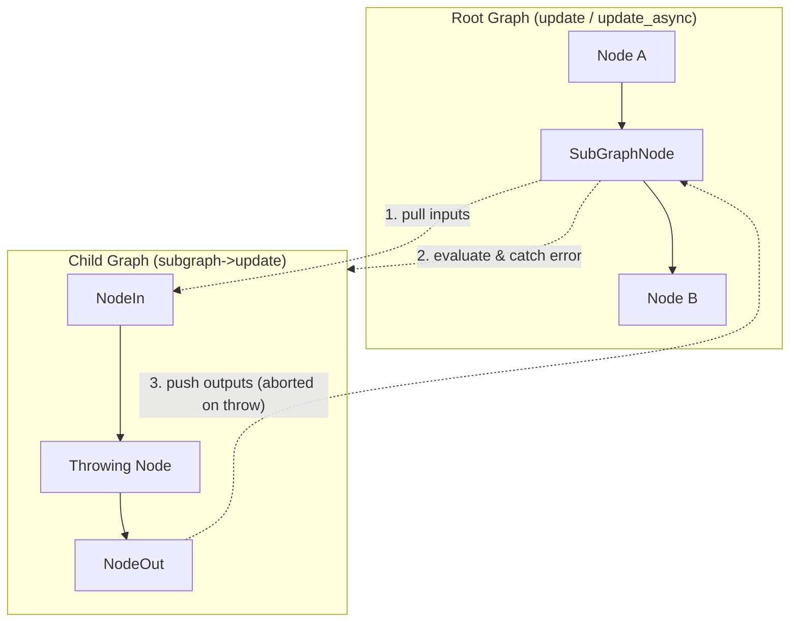
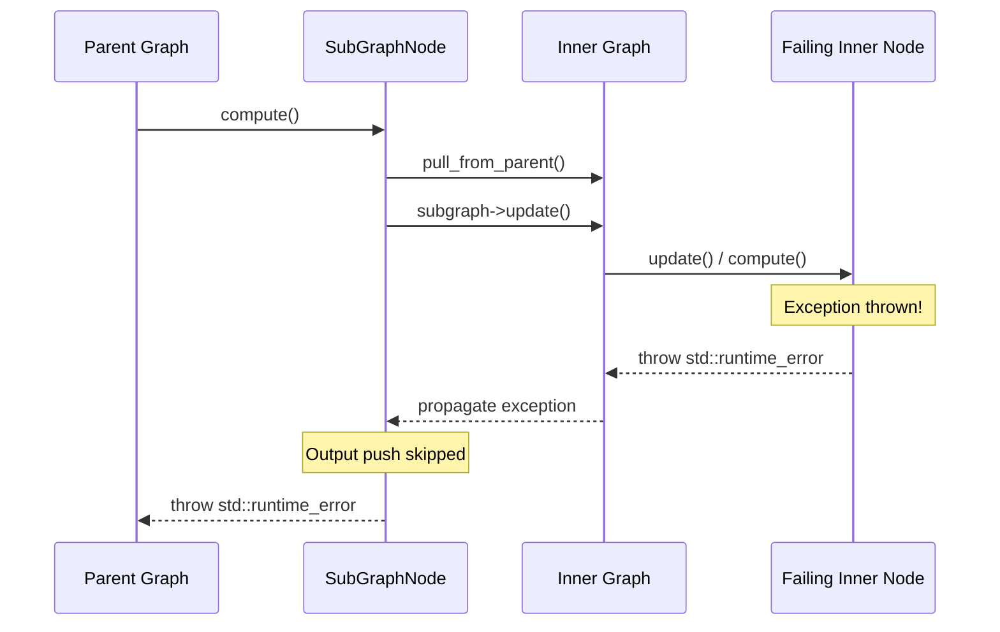
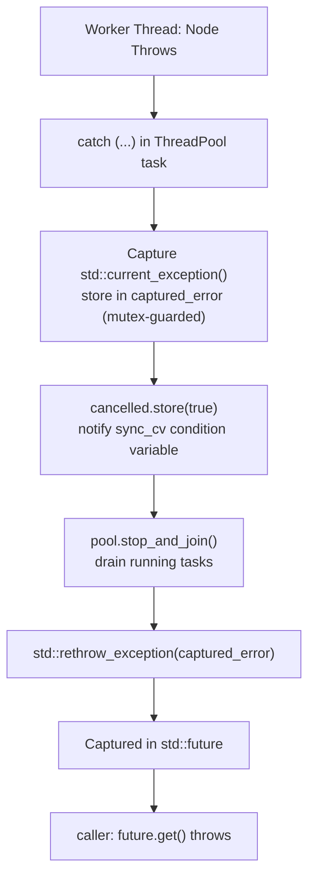
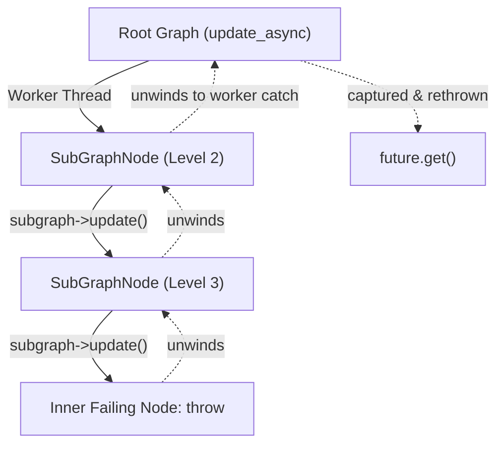

# SubGraph Exception Handling and Asynchronous Execution

This document details exception propagation, error handling, and thread synchronization guarantees when evaluating `SubGraphNode` instances in both synchronous and asynchronous modes.

## Overview

Hierarchical graphs in GNode encapsulate an inner `Graph` inside a `SubGraphNode`. When a graph contains nested subgraphs, exceptions occurring anywhere within the inner graph hierarchy must be safely captured, coordinated across worker threads, and cleanly rethrown to the caller.

## Exception Flow in SubGraphNode

The lifecycle of `SubGraphNode::compute()` operates in three distinct phases:

1. **Pull Step**: Reads input values from external parent ports into internal boundary nodes (`NodeIn<T>`).
2. **Evaluation Step**: Invokes `this->subgraph->update()`.
3. **Push Step**: Pushes resulting values from child boundary nodes (`NodeOut<T>`) out to external parent ports.

If any node inside the child graph throws an exception during **Step 2**:
- The exception immediately interrupts child graph traversal.
- **Step 3 is bypassed**, preventing partial, corrupted, or stale outputs from being published to the parent graph.
- The exception escapes `SubGraphNode::compute()` and unwinds into the parent graph execution engine.

## Asynchronous Catch and Rethrow Mechanics

In asynchronous or parallel graph updates (`Graph::update_async()` and `GraphWorker`), execution is coordinated across a worker pool. A failure within any node (including a `SubGraphNode` or an inner node within it) undergoes strict catch-and-rethrow coordination.

### 1. Worker Thread Capture
Inside `Graph::execute_parallel()`:
- Each node task is wrapped in a `try / catch (...)` block.
- When an exception escapes a node's `update()` method, `std::current_exception()` captures the exception pointer into `captured_error`.
- The first thrown exception is preserved; subsequent exceptions from concurrently completing tasks are discarded.

### 2. Immediate Graph Cancellation
Upon catching an exception:
- The atomic flag `cancelled` is set to `true`.
- Any queued tasks that have not yet started execution are skipped immediately.
- `sync_cv.notify_all()` awakens the supervising thread waiting in `sync_cv.wait()`.

### 3. Clean Thread Synchronization
- Before the exception is propagated out, `pool.stop_and_join()` joins all worker threads.
- This guarantees no dangling threads or orphaned memory references remain active when stack variables unwind.

### 4. Rethrow via Future
- The supervising thread checks `captured_error` and invokes `std::rethrow_exception(captured_error)`.
- Because `update_async` executes this pipeline inside `std::async(std::launch::async, ...)`, the rethrown exception is transported directly into the returned `std::future<void>`.
- When the caller calls `future.get()`, the original exception is rethrown on the caller's thread with its type and message intact.

## Nested Subgraphs

The exception guarantee holds recursively across arbitrary depths ($N$-level hierarchical nesting).

Even with multiple subgraphs evaluating concurrently on different threads, thread safety is maintained:
- Thread synchronization primitives prevent race conditions when multiple subgraphs fail simultaneously.
- Downstream nodes dependent on the failing subgraph are prevented from executing.
- Fixing the failing condition allows subsequent `update_async()` invocations to proceed without needing graph recreation.
