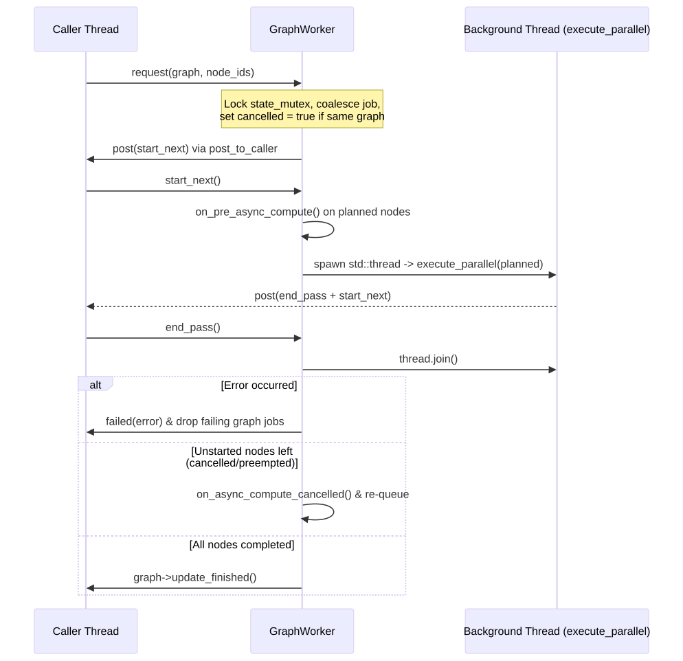

# Graph Update Process

GNode supports three update execution modes depending on whether evaluation is synchronous, deferred/debounced on a background thread, or parallelized across independent DAG branches.

---

## 1. Sequential Update (`Graph::update`)

In sequential mode, `Graph::update()` executes synchronously on the calling thread:

1. **Validation & Ordering**: Validates requested node IDs and computes a topological order (`topological_sort` for full updates, or `get_nodes_to_update` for selective updates). Throws `std::runtime_error` if a cycle is detected.
2. **Sequential Evaluation**: Iterates through the sorted nodes one by one, checking `cancel_update_callback(nid)` before each `node->update()`.
3. **Completion**: Fires `graph->update_finished()` once all scheduled nodes complete.

*(Source: [sequential_update.mmd](diagrams/sequential_update.mmd))*

---

## 2. Deferred Update with `GraphWorker`

`GraphWorker` (`GNode/include/gnode/graph_worker.hpp`, `GNode/src/graph_worker.cpp`) orchestrates non-blocking, debounced background updates:

1. **Request & Coalescing**: `GraphWorker::request(graph, node_ids)` acquires `state_mutex`, coalesces dirty node IDs into the pending `Job` for that graph, and sets `cancelled = true` if that graph is currently mid-pass.
2. **Pre-Compute Snapshot**: On the caller thread, `start_next()` calls `on_pre_async_compute()` on all planned nodes before spawning the background `std::thread`.
3. **Background Execution & Resumption**: The background thread runs `graph->execute_parallel(planned)`. When it finishes (or is cancelled), it posts `end_pass()` back to the caller thread via `post_to_caller`:
   - **Error**: Drops only the failing graph's queued jobs and invokes `failed(error)`.
   - **Preempted / Cancelled**: Calls `on_async_compute_cancelled()` on unstarted nodes and re-queues them with any newly requested nodes.
   - **Completed**: Fires `graph->update_finished()`.
4. **Synchronous Flush**: `GraphWorker::finish()` stops background work and drains remaining queued jobs synchronously, cleaning up `is_finishing` and `cancel_update_callback` even if a node throws.

> **Note:** `GraphWorker` already executes updates via `Graph::execute_parallel` (parallel DAG branch execution), so it provides both fire-and-forget scheduling (`GraphWorker::request()`) and parallel execution out of the box. Do not mix `Graph::update_async()` with `GraphWorker` on the same `Graph`—`update_async()` is a standalone `std::future<void>` wrapper around `execute_parallel` (whose destructor blocks) and bypasses `GraphWorker`'s synchronization and cancellation.

*(Source: [deferred_update_graph_worker.mmd](diagrams/deferred_update_graph_worker.mmd))*

---

## 3. Async Update with Parallel Graph Branch Execution (`Graph::execute_parallel`)

`Graph::execute_parallel(dirty_node_ids, num_threads)` (`GNode/src/graph.cpp`) parallelizes independent DAG branches using a `ThreadPool` (`GNode/include/gnode/thread_pool.hpp`):

1. **Cycle Check & In-Degree Graph**: Runs `topological_sort(dirty_node_ids)` to verify acyclicity, then builds atomic `in_degree[nid]` counters and `dirty_dw[nid]` adjacency lists restricted to the dirty set.
2. **Root Scheduling**: All nodes with `in_degree == 0` are enqueued immediately via `ThreadPool::enqueue_detached()`.
3. **Dynamic Fan-Out / Fan-In**: When a node finishes `node->update()`, it atomically decrements `in_degree[dw_id]` for each downstream dirty node. Whichever upstream branch decrements `in_degree` from `1` to `0` enqueues `dw_id`.
4. **Cancellation & Error Handling**:
   - Before executing or enqueuing, `cancelled.load()` and `cancel_update_callback(nid)` are checked.
   - If any node throws, the first exception is captured, `cancelled` is set to `true`, `sync_cv` is notified, `pool.stop_and_join()` waits for active workers, and the exception is rethrown.

*(Source: [async_parallel_update.mmd](diagrams/async_parallel_update.mmd))*
